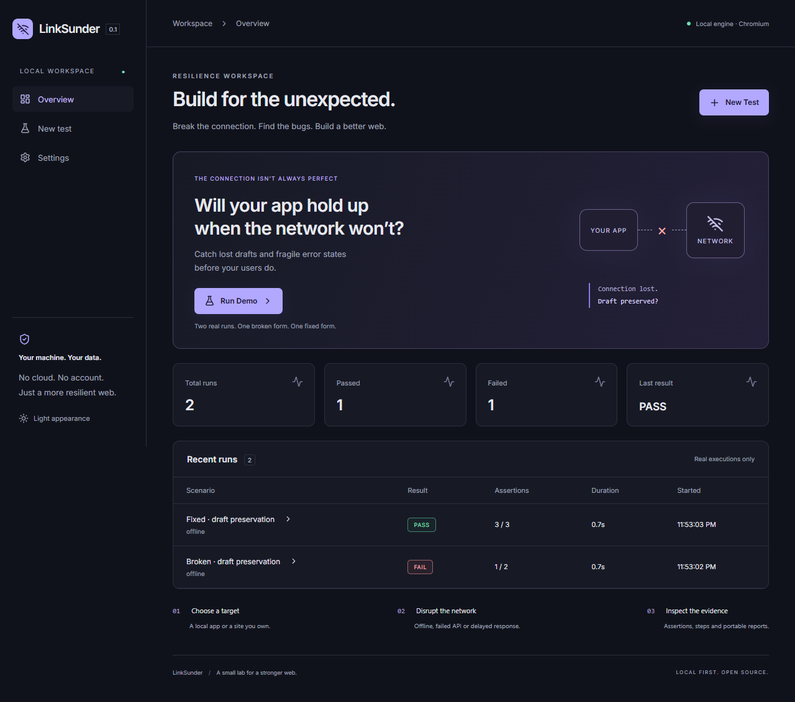

# LinkSunder

ابزاری متن‌باز و محلی برای آزمایش رفتار وب‌سایت هنگام قطع شبکه، خطای API و تأخیر درخواست‌ها.
بدون حساب کاربری، سرویس ابری یا API هوش مصنوعی کار می‌کند.



## شروع سریع

Node.js نسخه 22.12 به بالا (ترجیحاً 24 LTS) و npm لازم است.

```sh
npm install
npm run setup
npm run dev
```

آدرس `http://127.0.0.1:4317` را باز کنید و **Run Demo** را بزنید.
این دمو واقعاً فرم خراب و اصلاح‌شده را با Chromium آزمایش می‌کند:
نسخه خراب متن یادداشت را پاک می‌کند و FAIL می‌شود؛ نسخه اصلاح‌شده متن را حفظ می‌کند و PASS می‌شود.

برای نسخه ساخته‌شده، `npm run build` و سپس `npm run start` را اجرا کنید.
setup در ویندوز Chrome یا Edge موجود را بررسی می‌کند؛ در غیر این صورت Chromium را دانلود می‌کند.
در صورت محدودیت دانلود، مسیر مرورگر Chromium نصب‌شده را در `LINKSUNDER_BROWSER` تنظیم کنید.

## ساخت آزمون

در New Test، آدرس و نام را وارد کنید. مراحل را اضافه و مرتب کنید و برای نتیجه مشخص،
از Check Element یا Check Field Value استفاده کنید. برای تزریق خطای API یا تأخیر،
قاعده را قبل از مرحله‌ای قرار دهید که درخواست را ارسال می‌کند.
بدون assertion نتیجه فقط OBSERVED است و سلامت سایت تأیید نمی‌شود.

گزارش HTML مستقل از اینترنت و JSON از صفحه نتیجه قابل دریافت است.
تاریخچه در پوشه `data/` ذخیره می‌شود. با `LINKSUNDER_DATA` می‌توانید محل ذخیره را هنگام راه‌اندازی تغییر دهید.
تنظیم تم و مهلت پیش‌فرض از Settings در دسترس است؛ سناریوها به شکل فایل JSON وارد و خارج می‌شوند.

## امنیت و محدودیت‌ها

فقط سایت‌های خودتان یا سایت‌هایی را آزمایش کنید که مجوز دارید. اهداف خارجی تأیید صریح می‌خواهند.
داشبورد تنها روی loopback اجرا می‌شود. درخواست‌های خصوصی و metadata در تست خارجی مسدود می‌شوند.
این ابزار جایگزین sandbox امنیتی نیست و DNS rebinding را به‌طور کامل مسدود نمی‌کند.
گزارش‌ها درخواست، رمز یا کوکی را ثبت نمی‌کنند؛ اما محتوای صفحه می‌تواند خصوصی باشد.
اسکرین‌شات اختیاری است و فیلدها، `[data-sensitive]` و selectorهای انتخابی پوشانده می‌شوند.
تأخیر درخواست معادل شبیه‌سازی کامل اینترنت موبایل نیست.

## توسعه

`npm run lint`، `npm run typecheck`، `npm test` و `npm run test:e2e` را اجرا کنید.
تست‌های موتور واقعاً مرورگر را باز می‌کنند. [راهنمای انگلیسی](README.md) و [امنیت](SECURITY.md) جزئیات بیشتری دارند.
مجوز پروژه MIT است.
