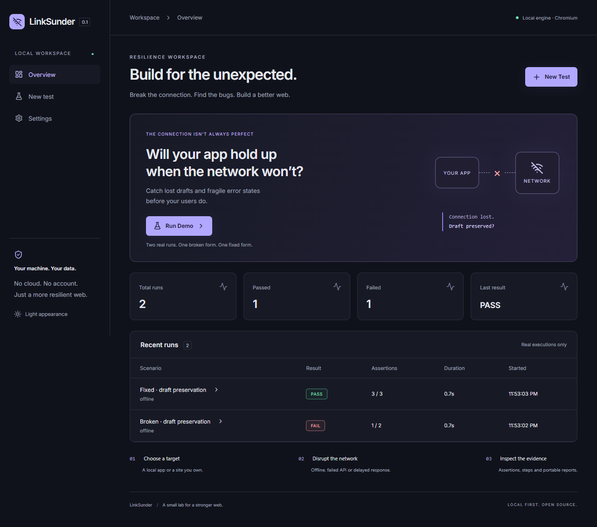
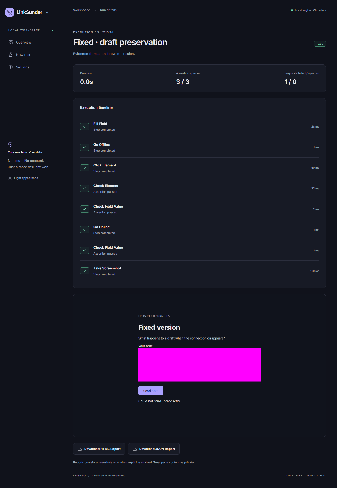

# ◇ LinkSunder

**Break the connection. Find the bugs. Build a better web.**

A local, open-source resilience lab for websites you own. Build a browser scenario,
disconnect the network, fail an API, or delay selected requests — then check whether
your UI preserves the state that matters. No account, cloud service, or AI API.

[راهنمای فارسی](README.fa.md) · [Scenarios](docs/scenarios.md) · [Security](SECURITY.md)



## Quick start

Requires **Node.js 22.12+** (24 LTS recommended), npm, and Git.

```sh
git clone https://github.com/kavianpcx/linksunder.git
cd linksunder
npm install
npm run setup
npm run dev
```

Open **http://127.0.0.1:4317** and click **Run Demo**. Setup verifies an existing
Chrome/Edge installation on Windows, or downloads Playwright Chromium. On Linux,
install Playwright's documented OS prerequisites if missing (`npx playwright install --with-deps chromium`).
If the browser CDN is unavailable, set `LINKSUNDER_BROWSER` to an installed Chromium
executable before setup and startup. No administrator rights are required by this app.

For a production build: `npm run build`, then `npm run start`.

## Demo: the same failure, two different outcomes

The bundled note form has two implementations. A real Chromium session fills a
draft, goes offline, clicks Send, waits for the error state, and checks the field.

| Scenario | Expected evidence |
| --- | --- |
| Broken | FAIL: the form clears the draft before the request succeeds |
| Fixed | PASS: the draft survives the failed send and reconnection |

The demo uses no external service. Its two results are saved to your real history.



## Features

- A responsive dashboard with dark/light themes, real history, and one active run.
- Ordered no-code steps: open, click, fill, offline, online, fail/delay API, check
  element/value, and screenshot. Add, edit, remove, or reorder; import/export JSON.
- Chromium network emulation and controlled HTTP 503 responses.
- Opt-in masked screenshots, cancellation, bounded timeouts, and isolated contexts.
- Self-contained offline HTML reports and JSON exports, persisted locally.
- No assertion means **OBSERVED**, never PASS. Failed assertions produce FAIL;
  setup/action errors produce ERROR, and stopped runs produce CANCELLED.

## How it works

The local API validates a scenario, opens an isolated headless Chromium context,
applies network rules, executes ordered steps, and evaluates explicit assertions.
Step status is polled by the dashboard; no synthetic progress percentages are used.
Runs are persisted in `data/` as JSON and standalone HTML with embedded PNGs.

API fault rules apply to subsequent requests whose pathname contains the configured
path. Delays affect selected HTTP requests, **not** mobile bandwidth, packet loss,
or a complete carrier network. Add a Click/Open step after installing an API rule
to trigger a request. A Quick Scan only changes network state and records observations;
it does not infer whether an application is healthy.

## Architecture

```text
client/   React + TypeScript dashboard, served through Vite in development
server/   Fastify API, Playwright runner, policy and report generation
shared/   Zod scenario schema and shared result types
demo/     Deliberately broken and corrected local form
tests/    Unit, browser integration and dashboard E2E tests
docs/     Scenarios, screenshots, release notes and launch drafts
```

The server binds only to `127.0.0.1`. The dashboard, API and demo share one port.
`PORT` changes it. `LINKSUNDER_DATA` selects a report directory; it is an operator
environment setting, never a path accepted from a browser request.

## Safety and limits

Use only on sites you own or have authorization to test. External targets require
explicit consent. HTTP(S) targets only; embedded URL credentials are rejected.
Other loopback origins, private and metadata IPs are blocked during external tests.
Requests and redirects are checked; service workers and WebSockets are disabled.
No saved browser profile, telemetry, request-body/header/cookie logging, or cloud upload.
Form fields and `[data-sensitive]` elements are masked in opt-in screenshots;
add extra selectors for other sensitive content. Scenario JSON may contain your
test inputs — protect it. Treat all reports and screenshots as private.

This is a trusted, single-user developer tool, **not a sandbox for hostile sites**.
DNS checks are not connection-level IP pinning and cannot eliminate DNS rebinding.
Browser background traffic, WebRTC and arbitrary third-party page behavior are not
fully sandboxed by HTTP routing. See [SECURITY.md](SECURITY.md) before external tests.
Scenarios are currently imported/exported as files; there is no scenario library,
authentication flow, full browser recorder, or automatic repair advice beyond
rule-based suggestions. English UI; Persian documentation included.

## Compared with existing tools

| Tool | Best fit |
| --- | --- |
| Browser DevTools | Manual network inspection and throttling in an interactive session |
| Playwright | Code-first browser automation with arbitrary assertions |
| LinkSunder | A small local UI for repeatable network-failure scenarios and portable evidence |

LinkSunder uses Playwright; it complements these tools and does not replace their flexibility.
References: [Chrome network tools](https://developer.chrome.com/docs/devtools/network/),
[Playwright network routing](https://playwright.dev/docs/network).

## Development and contributing

```sh
npm run lint
npm run typecheck
npm test
npm run test:e2e
npm run build
```

`npm test` includes real browser integration tests; run setup first. E2E tests use
fresh subdirectories in `.e2e-data/` and write real screenshots to `docs/screenshots/`.
Stop the development server before E2E tests (they own port 4317). CI covers checks on
Linux and Windows. See [CONTRIBUTING.md](CONTRIBUTING.md) and the [roadmap](docs/roadmap.md).

## License

[MIT](LICENSE). Contributions welcome.
